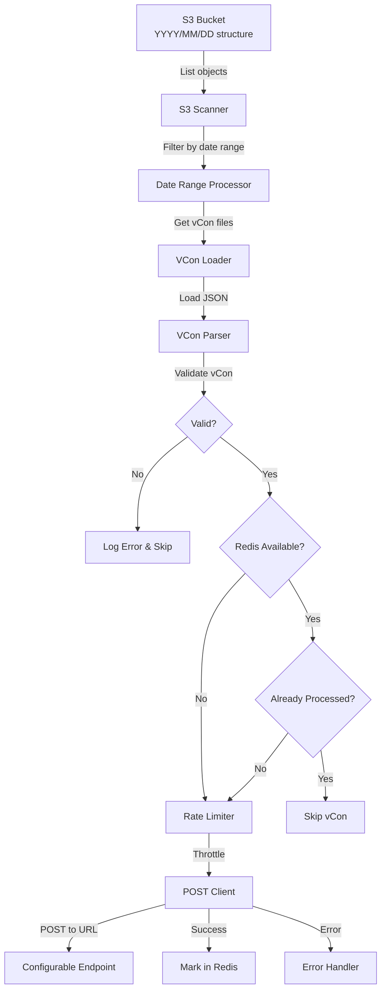

# vCon S3 Loader Service

A long-running Python service that loads vCon JSON files from S3 (organized by YYYY/MM/DD), POSTs them to a configurable URL with rate limiting, uses Redis for deduplication (optional), and supports programmable start date and upload rate.

## Features

- **S3 Integration**: Scans S3 buckets for vCon JSON files organized by date (YYYY/MM/DD)
- **Date-based Processing**: Processes dates from a configurable start date through today (backfill mode)
- **HTTP POST**: POSTs each vCon to a configurable endpoint with custom headers
- **Redis Deduplication**: Optional Redis integration to track processed vCons and prevent duplicates
- **Rate Limiting**: Configurable rate limiting for throttling POST requests
- **Checkpoint Management**: Saves/restores processing state to enable resuming after restarts
- **Metrics Tracking**: Tracks processed count, error count, success rate, and processing times
- **vCon Validation**: Validates vCons using the vCon library's `is_valid()` method
- **Security**: Supports multiple authentication methods (Bearer tokens, API keys, custom headers)
- **Resilience**: Exponential backoff retry logic, graceful degradation when Redis unavailable

## Architecture



## Installation

### Prerequisites

- Python 3.12 or higher (required by `vcon` 1.x)
- AWS credentials configured (via environment variables, IAM role, or AWS profile)
- Redis (optional, for deduplication)

### Install from Source

```bash
git clone <repository-url>
cd vcon-s3-loader
pip install -r requirements.txt
pip install -e .
```

### Development Installation

```bash
pip install -r requirements-dev.txt
```

## Configuration

Configuration can be provided via:
1. `.env` file (recommended for local development)
2. Environment variables
3. YAML/JSON configuration file

Configuration priority (highest to lowest):
1. Environment variables (set in shell)
2. Configuration file (YAML/JSON)
3. `.env` file
4. Default values

### .env File (Recommended)

Create a `.env` file in the project root or working directory:

```bash
# AWS Configuration
AWS_ACCESS_KEY_ID=your-access-key
AWS_SECRET_ACCESS_KEY=your-secret-key
AWS_REGION=us-east-1
S3_BUCKET_NAME=my-vcon-bucket
S3_PREFIX=vcons/

# POST Endpoint Configuration
POST_URL=https://api.example.com/vcons
POST_AUTH_TYPE=bearer
POST_AUTH_TOKEN=your-token-here
POST_USE_VCON_METHOD=false

# Rate Limiting
RATE_LIMIT_REQUESTS_PER_SECOND=10

# Processing Configuration
START_DATE=2024-01-01
POLL_INTERVAL_SECONDS=300
CHECKPOINT_FILE=.checkpoint.json
BATCH_SIZE=10
VALIDATE_VCON=true
MIGRATE_VERSION=false

# Redis Configuration (Optional)
REDIS_URL=redis://localhost:6379
REDIS_ENABLED=true
REDIS_KEY_PREFIX=vcon-loader

# Retry Configuration
RETRY_ATTEMPTS=3
RETRY_BACKOFF_BASE=2

# Logging
LOG_LEVEL=INFO
```

The `.env` file is automatically loaded if it exists in the current directory. You can specify a custom path with `--env-file`.

**Note:** The `.env` file should be added to `.gitignore` to avoid committing sensitive credentials.

### Environment Variables

You can also set environment variables directly in your shell:

```bash
# AWS Configuration
export AWS_ACCESS_KEY_ID=your-access-key
export AWS_SECRET_ACCESS_KEY=your-secret-key
export AWS_REGION=us-east-1
export S3_BUCKET_NAME=my-vcon-bucket
export S3_PREFIX=vcons/

# POST Endpoint Configuration
export POST_URL=https://api.example.com/vcons
export POST_AUTH_TYPE=bearer
export POST_AUTH_TOKEN=your-token-here
export POST_USE_VCON_METHOD=false

# Rate Limiting
export RATE_LIMIT_REQUESTS_PER_SECOND=10

# Processing Configuration
export START_DATE=2024-01-01
export POLL_INTERVAL_SECONDS=300
export CHECKPOINT_FILE=.checkpoint.json
export BATCH_SIZE=10
export VALIDATE_VCON=true
export MIGRATE_VERSION=false

# Redis Configuration (Optional)
export REDIS_URL=redis://localhost:6379
export REDIS_ENABLED=true
export REDIS_KEY_PREFIX=vcon-loader

# Retry Configuration
export RETRY_ATTEMPTS=3
export RETRY_BACKOFF_BASE=2

# Logging
export LOG_LEVEL=INFO
```

### Configuration File (YAML)

Create a `config.yaml` file:

```yaml
s3:
  bucket: my-vcon-bucket
  prefix: vcons/
  region: us-east-1

post:
  url: https://api.example.com/vcons
  headers:
    Authorization: Bearer your-token-here
    Content-Type: application/json
    X-API-Version: v1
  auth_type: bearer  # bearer, api_key, or custom
  use_vcon_method: false  # Use vCon library's post_to_url() if true
  retry_attempts: 3
  retry_backoff_base: 2  # seconds

rate_limit:
  requests_per_second: 10

processing:
  start_date: 2024-01-01
  poll_interval_seconds: 300
  checkpoint_file: .checkpoint.json
  batch_size: 10  # Optional: process in batches
  validate_vcon: true  # Validate vCon (core-05 rules) before posting
  migrate_version: false  # POST 0.4.0 vCons in their migrated 0.5.0 form

redis:
  url: redis://localhost:6379
  enabled: true
  key_prefix: vcon-loader

logging:
  level: INFO
```

## Usage

### Basic Usage

```bash
python -m src.main
```

### With .env File

```bash
# .env file is automatically loaded from current directory
python -m src.main

# Or specify custom .env file path
python -m src.main --env-file /path/to/custom.env
```

### With Configuration File

```bash
python -m src.main --config config.yaml
```

### With Custom Log Level

```bash
python -m src.main --log-level DEBUG
```

### Combining .env and Config File

```bash
# .env file loaded first, then config file (config file takes precedence)
python -m src.main --env-file .env --config config.yaml
```

### Docker Compose (with Redis)

```bash
docker-compose up -d redis
python -m src.main
```

## How It Works

1. **Backfill Mode**: The service processes all dates from `START_DATE` to today, processing vCons in chronological order.

2. **Monitoring Mode**: After backfill completes, the service periodically scans for new dates/files and processes them.

3. **Processing Flow**:
   - List S3 objects for a date (YYYY/MM/DD format)
   - Download and parse vCon JSON files
   - Validate vCons using `vcon.is_valid()`
   - Check Redis for deduplication (if enabled)
   - Rate limit POST requests
   - POST vCon to configured URL
   - Mark as processed in Redis
   - Save checkpoint

4. **Checkpoint Management**: The service saves checkpoints after processing each date, allowing it to resume from the last processed date after restarts.

5. **Error Handling**: Failed POSTs are retried with exponential backoff. Invalid vCons are logged and skipped.

### vCon versions

The loader uses `vcon>=1.0.3,<2`, which implements draft-ietf-vcon-vcon-core-05
(`"vcon": "0.5.0"`). Release 1.0.0 of the loader moved to it from `vcon` 0.x.

- **0.5.0** vCons are validated and posted as they are.
- **0.4.0** vCons are migrated to 0.5.0 by the library when they are loaded
  (Sessions are created, receivers move off the Dialogs, and so on), and the
  migrated form is what is validated. The original document is posted unless
  `MIGRATE_VERSION=true`, in which case the migrated 0.5.0 document is posted
  and the migration summary is logged. A signed (JWS) or encrypted (JWE) vCon
  is always posted unchanged.
- **Older syntax** (anything before 0.4.0, such as `"0.0.1"`) is not migrated
  and fails validation, so it is skipped while `VALIDATE_VCON=true`. Set
  `VALIDATE_VCON=false` to forward such archives unvalidated.

## Testing

### Run Unit Tests

```bash
pytest tests/
```

### Run with Coverage

```bash
pytest tests/ --cov=src --cov-report=html
```

### Run Integration Tests

Integration tests require:
- Moto (for S3 mocking)
- Fakeredis (for Redis mocking)

```bash
pytest tests/test_integration.py
```

## Project Structure

```
vcon-s3-loader/
├── src/
│   ├── __init__.py
│   ├── main.py                 # Entry point and service orchestration
│   ├── config.py               # Configuration management
│   ├── s3_client.py            # S3 listing and file retrieval
│   ├── redis_client.py         # Redis deduplication tracking
│   ├── http_client.py          # HTTP POST client
│   ├── rate_limiter.py         # Rate limiting logic
│   ├── date_processor.py       # Date range processing logic
│   ├── checkpoint.py           # Checkpoint management
│   ├── vcon_loader.py          # VCon file loading and parsing
│   └── metrics.py              # Metrics tracking
├── tests/
│   ├── __init__.py
│   ├── test_config.py
│   ├── test_s3_client.py
│   ├── test_redis_client.py
│   ├── test_http_client.py
│   ├── test_rate_limiter.py
│   ├── test_date_processor.py
│   ├── test_checkpoint.py
│   ├── test_vcon_loader.py
│   ├── test_metrics.py
│   ├── test_main.py
│   ├── test_integration.py
│   └── fixtures/
│       └── sample_vcon.json
├── requirements.txt
├── requirements-dev.txt
├── setup.py
├── pyproject.toml
├── docker-compose.yml
├── .env.example
└── README.md
```

## Configuration Options

### S3 Configuration

- `S3_BUCKET_NAME`: Name of the S3 bucket (required)
- `S3_PREFIX`: Optional prefix to filter objects
- `AWS_REGION`: AWS region (default: us-east-1)

### POST Configuration

- `POST_URL`: Target endpoint URL (required)
- `POST_HEADERS`: Custom headers (JSON format)
- `POST_AUTH_TYPE`: Authentication type (bearer, api_key, custom)
- `POST_AUTH_TOKEN`: Authentication token/API key
- `POST_USE_VCON_METHOD`: Use vCon library's `post_to_url()` method. This posts the loaded `Vcon` object, so a 0.4.0 vCon is sent in its migrated 0.5.0 form whatever `MIGRATE_VERSION` says.
- `RETRY_ATTEMPTS`: Number of retry attempts (default: 3)
- `RETRY_BACKOFF_BASE`: Base seconds for exponential backoff (default: 2)

### Rate Limiting

- `RATE_LIMIT_REQUESTS_PER_SECOND`: Maximum requests per second (default: 10)

### Processing Configuration

- `START_DATE`: Start date in YYYY-MM-DD format (required)
- `POLL_INTERVAL_SECONDS`: Seconds between S3 scans after backfill (default: 300)
- `CHECKPOINT_FILE`: File path for checkpoint (default: .checkpoint.json)
- `BATCH_SIZE`: Number of vCons to process in batch (default: 1)
- `VALIDATE_VCON`: Validate vCon before posting (default: true). See [vCon versions](#vcon-versions).
- `MIGRATE_VERSION`: POST a 0.4.0 vCon in its migrated 0.5.0 form instead of the original document (default: false). See [vCon versions](#vcon-versions).

### Redis Configuration

- `REDIS_URL`: Redis connection URL (default: redis://localhost:6379)
- `REDIS_ENABLED`: Enable Redis (default: true)
- `REDIS_KEY_PREFIX`: Prefix for Redis keys (default: vcon-loader)

### Logging

- `LOG_LEVEL`: Logging level (DEBUG, INFO, WARNING, ERROR, CRITICAL)

## Troubleshooting

### S3 Access Issues

- Verify AWS credentials are configured correctly
- Check IAM permissions for S3 bucket access
- Ensure bucket exists and is accessible

### Redis Connection Issues

- Verify Redis is running and accessible
- Check Redis URL format (redis://host:port)
- Service will continue without Redis if connection fails (deduplication disabled)

### POST Request Failures

- Check endpoint URL is correct and accessible
- Verify authentication headers are correct
- Review retry logs for specific error messages
- Check rate limiting settings

### Validation Errors

- Review vCon structure against vCon specification
- Check for required fields (uuid, parties, dialog)
- Verify JSON format is valid

### Checkpoint Issues

- Check file permissions for checkpoint file
- Verify checkpoint file is not corrupted
- Delete checkpoint file to restart from beginning (if needed)

## Metrics

The service tracks the following metrics:

- `processed_count`: Number of successfully processed vCons
- `error_count`: Number of errors encountered
- `skipped_count`: Number of skipped vCons (already processed)
- `validation_error_count`: Number of validation errors
- `redis_unavailable_count`: Number of times Redis was unavailable
- `success_rate`: Success rate (processed / (processed + error))
- `average_processing_time`: Average processing time per vCon
- `dates_processed_count`: Number of dates processed
- `last_processed_date`: Last processed date
- `last_processed_time`: Timestamp of last processed vCon

Metrics are logged periodically and available in the service summary.

## Security Considerations

- **Authentication**: Use environment variables for sensitive tokens (not config files)
- **HTTPS**: Always use HTTPS for POST endpoints
- **IAM Roles**: Prefer IAM roles over access keys when possible
- **Redis Security**: Use Redis AUTH if Redis is exposed
- **Signed/Encrypted vCons**: Service preserves JWS/JWE format without modification

## License

MIT License

## Contributing

Contributions are welcome! Please ensure:

1. Code follows PEP 8 style guidelines
2. Tests are included and pass
3. Documentation is updated
4. Type hints are used where appropriate

## Support

For issues and questions, please open an issue on the repository.

